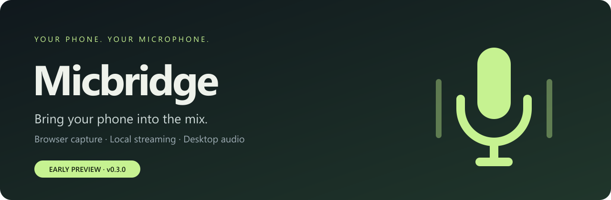
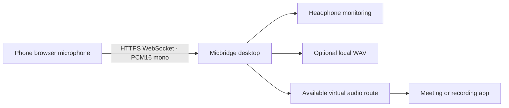

<p align="center">
  
</p>

<p align="center"><strong>A browser microphone for your desktop. Pair once. Open. Speak.</strong></p>
<p align="center">Created by <strong>Iñaki Abadia</strong> · MIT licensed · Early preview</p>
<p align="center"><a href="#get-started">Get started</a> · <a href="#platform-support">Platform support</a> · <a href="docs/SETUP.md">Setup guide</a> · <a href="#roadmap">Roadmap</a></p>

Micbridge streams your phone's microphone to a desktop on the same local network. The phone runs a browser app; the desktop receives audio, provides listening and recording controls, and can route it to an available virtual microphone.

> **Early preview · 0.3.1** — Windows desktop monitoring has been tested with an iPhone. Linux/macOS builds pass CI; audio routing still needs hardware validation. Safari screen locking can interrupt streaming; keep the phone app open and the screen awake.

## Make the microphone you already own useful

| Pair once | Control your sound | Keep it local |
| --- | --- | --- |
| Enter a six-digit desktop code. Saved pairing uses a secure cookie; the phone URL stays clean. | Adjust gain up to 600%, mute, toggle browser noise reduction, and choose desktop audio output. | Stream over local HTTPS. Save WAV recordings only when you choose to record. |

- **A phone app without deployment.** Open the served web app in Safari or another compatible browser, or add it to your home screen.
- **A desktop that stays out of the way.** Integrated window controls, a tray icon, and optional start at login on Windows/macOS.
- **Useful feedback.** Input meter, frame counters, transfer totals, playback queue, and underrun indicators.
- **Flexible routing.** Monitor with headphones or send audio to a supported virtual device for another application.

## Get started

Download the [Windows preview](https://github.com/iAbadia/micbridge/releases/tag/v0.3.1) and choose the setup wizard or portable executable. It is unsigned; Windows may show a SmartScreen warning. The phone app is served by the desktop, so no separate phone download is needed.

GitHub builds include a Windows **setup** executable with an installation wizard and a separate **portable** executable. On macOS, open the DMG and drag the app into Applications. On Linux, install the `.deb` using your package manager, or make the AppImage executable and run it.

### Run from source

Use Node.js 24 LTS and npm. No other microphone app, native helper, or .NET SDK is required.

```sh
npm ci
npm start
```

Prefer a browser dashboard instead of the desktop shell?

```sh
npm run serve
```

### Connect your phone

1. Keep the desktop running and connect both devices to the same reachable network.
2. For iPhone, choose **First-time iPhone setup** on the desktop. Install the certificate profile and enable full trust in iOS. This is a one-time local HTTPS setup.
3. Open the desktop's phone link, or save it with Safari's **Add to Home Screen**.
4. Inside the phone app, enter the **six-digit desktop code** once. Tap **Start microphone** and grant microphone access.
5. Wear headphones and enable **Desktop output** to listen. Configure a virtual audio route if you want another app to use it as a microphone.

The default phone address is `https://YOUR-DESKTOP-IP:8443/phone`. Reserve the desktop's IP in your router to keep the address stable. Port 8442 serves public certificate setup material; microphone audio and pairing use HTTPS on 8443.

Visit the [project homepage](https://iabadia.github.io/micbridge/). See the [setup guide](docs/SETUP.md) for certificate trust, environment variables, routing, and build commands.

## Platform support

| Platform | Current status | Audio routing |
| --- | --- | --- |
| **Windows desktop** | Local build and runtime tested | Desktop monitoring; independent virtual audio cable for use in other apps |
| **Linux desktop** | Implemented; runtime unverified | PulseAudio / PipeWire compatibility using `pactl` and `pacat` |
| **macOS desktop** | Builds pass CI; runtime unverified | An externally installed virtual audio device is required |
| **iPhone / Safari** | User confirmed audible desktop monitoring | Foreground browser capture; locked-screen streaming is not reliable |
| **Android browser** | Implemented; device unverified | Requires trusted HTTPS and microphone permission |

Micbridge has no dependency on other microphone software. It does not install a Windows kernel driver. For meeting/recording apps on Windows, install an independent virtual audio cable and choose its playback endpoint under Desktop output, then its recording endpoint in the consuming app. A Micbridge-owned Windows virtual driver is implemented in the development source; its dedicated CI builds an unsigned package. Production signing and real Windows audio testing are still required before it can ship in normal installers. See the [driver documentation](native/windows-driver/README.md).

## Privacy and pairing

Audio travels between your phone and desktop over the local network. The app has no account system, vendor telemetry, or third-party audio upload. WAV recordings stay in the local app data directory and require explicit recording activation.

Pairing codes are single-use, expire after ten minutes, and have a global attempt limit. The phone stores its pairing in a persistent Secure, HttpOnly cookie. **Forget paired phones** revokes it. Clearing website data or changing the IP/hostname can require pairing again.

The desktop creates a local certificate authority for HTTPS. Install its certificate only on devices you control, and keep its private keys private. Do not expose the app's ports directly to the public internet.

## Under the hood



The desktop uses Electron and TypeScript; browser capture uses an AudioWorklet. Audio uses 20 ms mono PCM frames over WebSocket. Browser noise reduction uses the browser's processing rather than a bundled neural model.

## Development

```sh
npm test           # Build and run the automated checks
npm run package    # Build an unpacked desktop app
```

For Windows packaging:

```sh
node scripts/release-notices.mjs
npm run dist:win
```

Build Linux/macOS packages on their respective hosts with `npm run dist:linux` or `npm run dist:mac`. CI builds do not replace audio routing tests on actual hardware. Current preview binaries are unsigned.

## Roadmap

Release downloads can be built entirely on GitHub. See [the release workflow guide](docs/RELEASING.md) for tag-triggered builds and draft releases.

- Validate home-screen pairing persistence and recovery on real iPhones.
- Test long-session latency, clock drift, and interruption recovery.
- Move transmission toward compressed WebRTC/Opus audio.
- Provide independent Windows virtual microphone installation.
- Validate Linux and macOS routing and packaging.
- Explore a lightweight native mobile companion for reliable locked-screen capture.
- Add signed releases and a reviewed update path.

## License and credits

Created by **Iñaki Abadia**. Copyright © 2026 Iñaki Abadia.

Micbridge is released under the [MIT License](LICENSE). Use, modification, distribution, and commercial use are permitted subject to preserving the copyright and license notice. Third-party dependencies retain their own licenses.

Micbridge is an independent implementation informed by investigation of an installed Windows client. Proprietary applications, decompiled source, model files, and third-party branding are excluded from the public repository. See the [publication checklist](docs/PUBLISHING.md) for release readiness.
